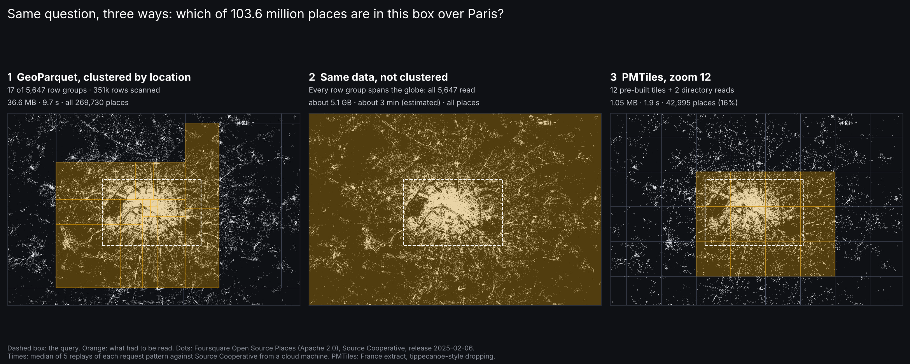
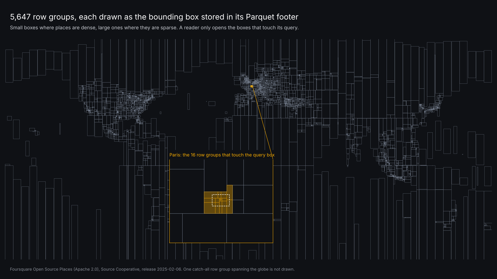

# Day 1 · Points: 103.6 million places, read by the viewport

One question asked three ways: which places fall inside a box over Paris?

## Data

Foursquare Open Source Places, release 2025-02-06, via Source Cooperative (`fused/fsq-os-places`), Apache 2.0.
82 GeoParquet files, 16.9 GB, 103,561,079 rows in 5,647 row groups. Partitioned spatially by Fused; each row group carries min/max statistics on a `bbox` struct column.

Query box: lon 2.22 to 2.47, lat 48.80 to 48.91.

## What we measure for each method

| Measure | How |
| --- | --- |
| Total points | Sum of `num_rows` from the Parquet footers (no data read) |
| Rows scanned | Rows in row groups whose bbox statistics overlap the query box |
| Bytes downloaded | DuckDB HTTP stats, footer and column chunk sizes, PMTiles directory and tile sizes |
| Requests | Count of HTTP range requests |
| Time | Replay of each request pattern against Source Cooperative, median of 5 |

## The three methods

1. **GeoParquet as published (clustered by location).** DuckDB-wasm reads each file's footer, skips row groups whose statistics miss the box, fetches the rest by range.
   First native run (cloud VM): 17 of 5,647 row groups, 351,087 rows scanned, 34.4 MiB in, 143 GET and 165 HEAD requests, 10.2 s. The 17 includes one catch-all row group (5,646 rows) whose bbox spans the globe, so every query reads it.
   Most of the 10 s is round trips: 82 footers before any data. A file-level index (STAC GeoParquet or the dataset's `_metadata` summary) would let the client skip whole files first.
2. **Same rows, shuffled.** World scale is computed, not downloaded: with shuffled rows every row group spans the globe, so all 5,647 are read, about 5.1 GB for lon, lat, name and bbox.
   Not downloaded: the 5.1 GB is the sum of the needed column chunks across all row groups, and the time is that size at the measured throughput.
3. **PMTiles.** France extract (3,061,822 places) tiled with `scripts/make_pmtiles.py`, which follows tippecanoe's defaults (drop rate 2.5, 500 KB tile cap). Requests and bytes counted by emulating pmtiles.js; time from replaying that pattern.

## Closing point for the post

PMTiles and pre-built GeoParquet are both fast because the work was done ahead of time. Neither handles dynamic combinations well: a new filter, a join with another dataset, or an aggregation that changes per user. GeoParquet is the easier of the two to regenerate on the fly; when that churn is constant, server-side dynamic tiling from the warehouse is the better trade.

## Files

- `scripts/extract_metadata.py`: footers only, writes `rg.parquet` (row-group boxes) and the Paris dot layer
- `scripts/make_figure.py`: the three-panel figure
- `scripts/make_pmtiles.py`, `scripts/measure_pmtiles.py`, `scripts/replay_timing.py`: PMTiles build, request measurement, timing replay
- `scripts/make_world_figure.py`: the world map of row-group boxes

No live demo for day 1: the PMTiles archive (172.6 MB) is over GitHub Pages' 100 MB file limit.

## Results (2026-11-01, replayed from a cloud machine)

| Method | Requests | Downloaded | Time | Places shown in the box |
| --- | --- | --- | --- | --- |
| GeoParquet, clustered | 167 | 36.6 MB (20.2 MB of it footers) | 9.7 s | 269,730 (all) |
| GeoParquet, not clustered | all chunks | about 5.1 GB | about 3 min (estimated) | all |
| PMTiles z12 | 14 | 1.05 MB | 1.9 s | 42,995 (16%) |
| PMTiles z14 | 110 | 5.8 MB | 6.8 s | 269,730 (all) |

Method: `scripts/replay_timing.py` replays each method's exact request pattern (count, sizes, phases, 6 parallel connections) as real range requests against Source Cooperative; median of 5. The GeoParquet replay (9.7 s) matches the real DuckDB query (10.2 s). PMTiles built with `scripts/make_pmtiles.py`, a small point tiler with tippecanoe's default drop rate (2.5) and 500 KB tile cap.
