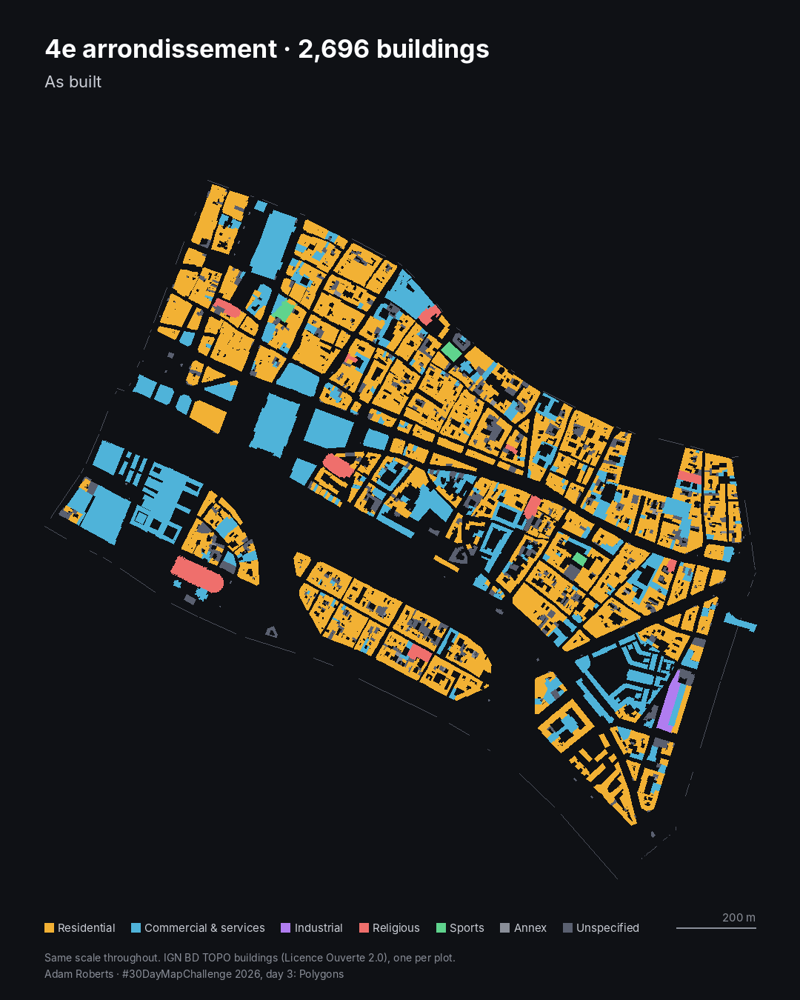

# Day 3 · Polygons: Paris, sorted

Every building in each Paris arrondissement, coloured by use, then lifted off the map and packed into rows from largest to smallest at the same scale.

**Live page:** https://abenrob.github.io/30daymap2026/day-03-polygons/ (pick an arrondissement; Map, Shares and Sorted tabs; links like `#a=11&v=sorted` open a given view)

- [`images/day03-4e.gif`](images/day03-4e.gif): the posted loop, 4e arrondissement, grouped by use, long side horizontal. 1080 x 1350, 20 fps, 4.2 MB.
- The same loop as an antialiased 25 fps MP4 is kept outside the repo (`.gitignore` excludes video); `scripts/04_make_animation.py` rebuilds it.
- [`images/4e-map.png`](images/4e-map.png), [`images/4e-sorted.png`](images/4e-sorted.png): the two end states.

## Data

| Layer | Source | Notes |
| --- | --- | --- |
| Buildings | IGN BD TOPO, layer `BDTOPO_V3:batiment`, Géoplateforme WFS | Licence Ouverte 2.0. Buildings in service only. Use from `usage_1` |
| Arrondissements | IGN ADMIN EXPRESS COG, `arrondissement_municipal` | Licence Ouverte 2.0 |

Two things to know when reading the numbers:

- BD TOPO cuts continuous street blocks into one building per plot, so a Haussmann block counts as several buildings. "Buildings" here means those pieces.
- 19% of buildings carry BD TOPO's own *Indifférencié* use, shown as "Unspecified". BD TOPO files public buildings (the Hôtel-Dieu hospital, the Hôtel de Ville) under *Commercial et services*.

## Pipeline

Run from a working folder outside the repo, in order:

1. `scripts/01_fetch_bdtopo.py`: downloads every building over Paris from the WFS in 0.01° tiles, each under the 5,000-feature page size (225 tiles, about 5 minutes).
2. `scripts/02_prep.py`: merges the tiles, drops duplicates and buildings not in service, and assigns each building to the arrondissement that contains a point inside it.
3. `scripts/03_export.py`: writes `buildings/index.json` (per-arrondissement shares by use and size, plus the picker outlines) and one `buildings/arrNN.json` per arrondissement: use, area, height, dwellings, the long-axis angle of the minimum rotated rectangle, and the outline in Lambert-93 decimetres relative to the arrondissement's corner (simplified at 0.3 m).
4. `scripts/04_make_animation.py 4 [ss]`: renders the loop as PNG frames. Encode with ffmpeg:
   - MP4 (`ss` = 2): `ffmpeg -framerate 25 -i frames/%04d.png -c:v libx264 -pix_fmt yuv420p -crf 18 day03-4e.mp4`
   - GIF (`ss` = 1, crisp edges keep it under LinkedIn's 5 MB): palettegen with 32 colours, then paletteuse with `dither=none:diff_mode=rectangle` at 20 fps.

Python: `geopandas`, `shapely>=2`, `pyarrow`, `pillow`.

## How the sorting works

Each footprint is rotated so its long side is horizontal (the long axis of its minimum rotated rectangle), then placed left to right in rows, largest first, wrapping when a row is full; each row is as tall as its first building. With grouping on, each use starts a new block. The page computes the layout in the browser on a canvas; map and sorted views share one scale in the animation, so sizes stay true.

## Numbers

| | |
| --- | --- |
| Buildings in Paris | 118,462 in service, from 254,279 features over the Paris bounding box |
| 4e arrondissement | 2,696 buildings, 0.63 km² of footprint on 1.60 km² of land |
| 4e median footprint | 147 m²; largest 11,592 m² (the Hôtel-Dieu) |
| 4e concentration | The largest 10% of buildings cover 44% of the footprint; the smallest half covers 16% |
| 4e by size | Over 1,000 m²: 2.4% of buildings, 24% of footprint. Under 50 m²: 17% of buildings, 1.5% of footprint |
| 4e by use | Commercial and services: 11% of buildings, 27% of footprint |
