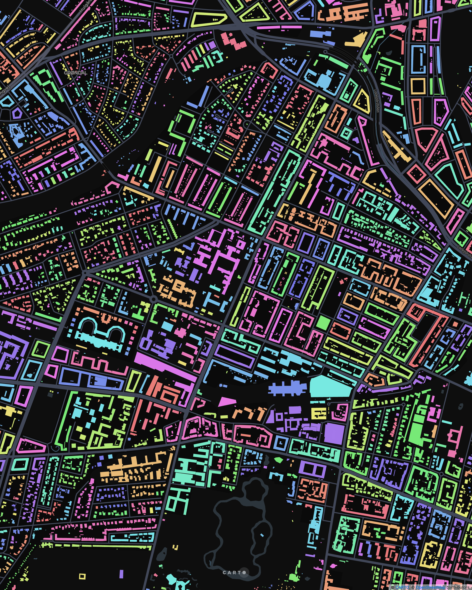
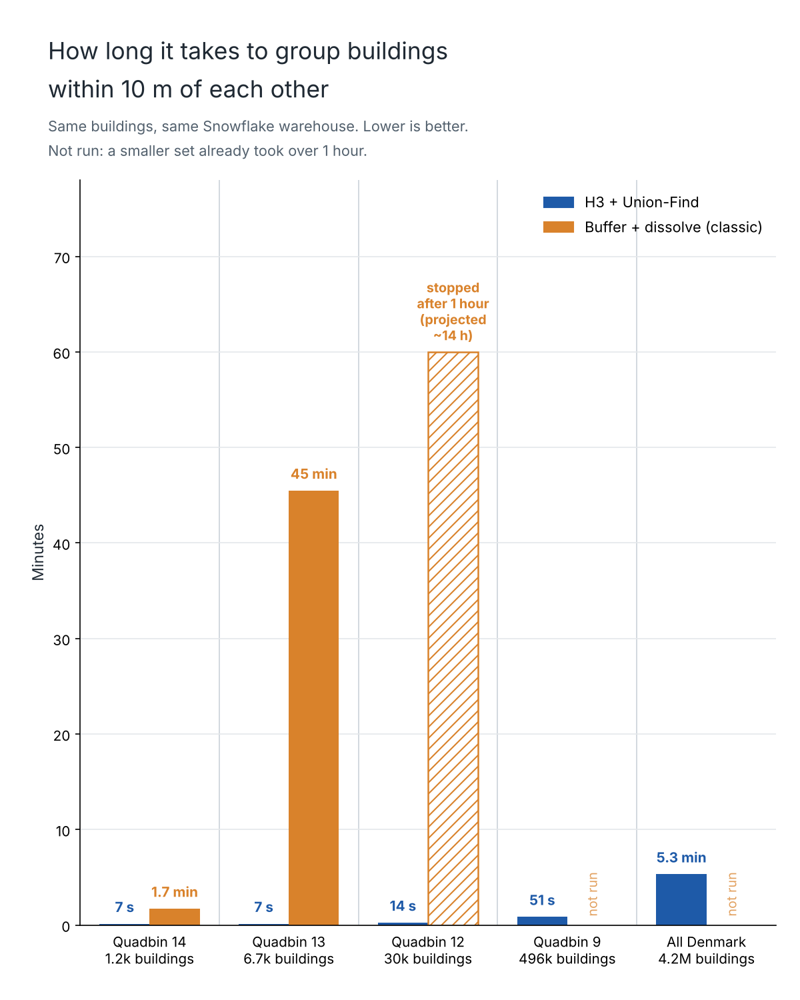

# Day 4 · Clusters: every building in Denmark grouped at 10 m, inside Snowflake

4,163,573 building footprints grouped into settlements in 5.3 minutes, in one SQL statement on a Small Snowflake warehouse.

Explore the map: https://clausa.app.carto.com/map/c5aa833e-6180-4c49-891c-ba54a64e8455

## The rule

Two buildings belong to the same cluster if their footprints are within 10 m of each other, directly or through a chain of neighbours. Distance is footprint to footprint, not centroid to centroid. There is no minimum-neighbour rule, so an isolated building is a cluster of one. The result is the same as buffer-and-dissolve, or DBSCAN with `min_samples = 1` on polygons.

## Method: H3 + union-find

1. Cover each footprint with every H3 cell (resolution 11) it touches.
2. Expand each cell by 2 rings and join on cell ID to find candidate pairs (a plain ID match).
3. Run the exact `ST_DISTANCE` check only on the candidate pairs.
4. Partition the matched pairs by a coarse H3 parent cell (resolution 6).
5. Run a Python union-find UDTF per partition, all partitions in parallel.
6. A final pass merges clusters that cross partition borders.

Everything runs in the warehouse: no export, no extra tool, no second copy of the data. Nothing in it is specific to Denmark.

## Comparison: buffer + dissolve

The classic pipeline on the same warehouse: buffer each footprint by 5 m (CARTO Analytics Toolbox `ST_BUFFER`, since Snowflake's native buffer only works on GEOMETRY), dissolve with `ST_UNION_AGG`, split into polygons, assign buildings back.

| Buildings | H3 + union-find | Buffer + dissolve |
| --- | --- | --- |
| 1,249 | 7 s | 1.7 min |
| 6,708 | 7 s | 45.5 min |
| 29,845 | 14 s | stopped after 1 hour |
| 496,133 | 51 s | not run |
| 4,163,573 (Denmark) | 5.3 min | not run |

Test extracts are nested quadbin cells anchored in Nørrebro, built before timing starts. Only the clustering statement is timed; each run is capped at 1 hour, and the classic method was not run on extracts larger than one it had already failed to finish.

Caveats: the classic time includes the toolbox buffer, and buffer and union were not timed separately, so read this as "this buffer-and-dissolve pipeline was slower", not "dissolve is slow". At small sizes union-find has little to parallelise and fixed overhead dominates.

Correctness: a brute-force `ST_DWITHIN` check at 1,249 and 6,708 buildings found every pair within 10 m kept together by union-find, with exactly one cluster per building.

## Not DBSCAN (yet)

Full DBSCAN is a couple of steps away: count each building's neighbours from the same pair table to flag core points, join only core-to-core pairs, and attach border buildings to a neighbouring core.

## Data

Building footprints: Overture Maps Foundation, ODbL. Basemap: © CARTO, © OpenStreetMap contributors.
