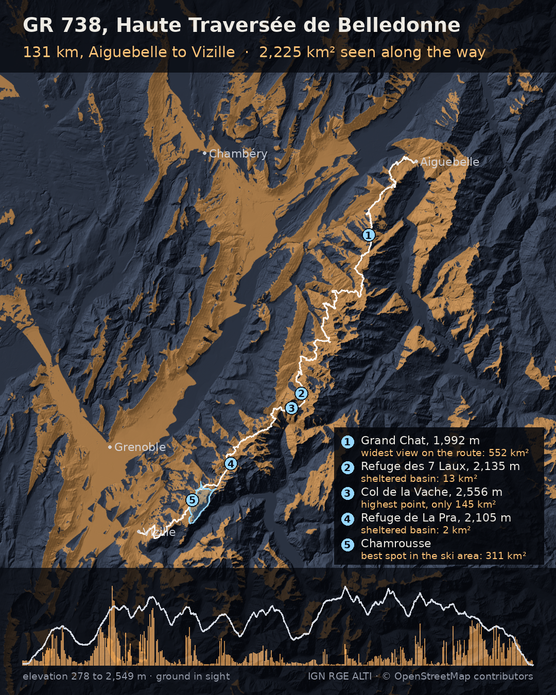

# Day 5 · Senses: Sight

What a walker on the GR 738, the Haute Traversée de Belledonne, can see from every point of the trail: 900 viewsheds, one about every 150 m over 131 km from Aiguebelle to Vizille, all `gdal_viewshed`, drawn as a video. [Watch it here](https://abenrob.github.io/30daymap2026/day-05-senses-sight/).



## GR 738 (the published version)

### Data

- Trail: the 11 OpenStreetMap stage relations "La Haute Traversée de Belledonne - Etape 1" to "Etape 11" (11999801, 11999979, 12000627, 12000630, 12000639, 12000790, 12000872, 12000902, 12000917, 12000916, 12000989), © OpenStreetMap contributors, ODbL. Chained in stage order: 331 ways, no gaps, 131.5 km.
- Terrain: IGN RGE ALTI via the Géoplateforme WMS-R (`ELEVATION.ELEVATIONGRIDCOVERAGE`, float32 GeoTIFF), 25 m, trail bounding box + 35 km (110 x 125 km), averaged to 50 m for the viewsheds. Licence Ouverte 2.0.

```
[out:json][timeout:120];rel["route"="hiking"]["ref"~"738"](44.9,5.6,45.7,6.5);out tags;
[out:json][timeout:170];rel(id:11999801,11999979,12000627,12000630,12000639,12000790,12000872,12000902,12000917,12000916,12000989);out body;way(r);out geom;
```

Places of interest (saved as `raw/gr738_pois.json`, `gr738_huts.json`, `gr738_ski_geom.json`):

```
[out:json];(node["natural"~"^(peak|saddle)$"](45.05,5.75,45.56,6.33);node["mountain_pass"="yes"](45.05,5.75,45.56,6.33);node["tourism"~"^(alpine_hut|wilderness_hut|viewpoint)$"](45.05,5.75,45.56,6.33);node["natural"="water"]["water"="lake"]["name"](45.05,5.75,45.56,6.33););out body;
[out:json];nwr["tourism"~"^(alpine_hut|wilderness_hut)$"](45.05,5.75,45.56,6.33);out center tags;
[out:json];nwr["landuse"="winter_sports"](45.0,5.7,45.6,6.4);out geom;
```

### Method

1. `15_gr738_prep.py`: chain the stages, resample to 900 points (30 s at 30 fps), fetch the DEM.
2. `16_gr738_viewsheds.py`: `gdal_viewshed -oz 1.7 -tz 0 -cc 0.85714` at every point, no maximum distance: can an eye 1.7 m above the trail see the ground itself, with Earth curvature and standard refraction. Masks kept bit-packed (one file) with per-frame areas.
3. `17_gr738_frames.py`: dark hillshade from the 25 m DEM, ground in sight in amber, ground already seen as a faint tint, trail, caption, profile strip. At five places the walker pauses 1.2 s and a label fades in (the Chamrousse ski area fades in while the walker is inside it). The end card shows everything seen, with the five places numbered. ffmpeg encodes H.264, 39 s.

Places of interest come from OpenStreetMap (peaks, cols, refuges, ski areas within the trail's bounding box). A label's number is the ground in sight from the trail point nearest the place, except the Grand Chat, where the pause is on the summit ridge 220 m before the point, where the route's widest view is.

### Results (2 vCPU cloud machine)

| | |
| --- | --- |
| 900 viewsheds | 237 s (0.26 s each) |
| Ground in sight, median | 43.7 km² |
| Median above 2,000 m / below 1,500 m | 35.8 / 34.2 km² (height barely predicts the view) |
| Seen at least once | 2,225 km² (of 13,725 km² loaded) |
| Farthest visible ground (every 10th frame) | median 54 km, max 93 km |

| Place | km | Altitude | Ground in sight |
| --- | --- | --- | --- |
| Grand Chat (summit ridge) | 23.1 | 1,992 m | 552 km², the widest on the route |
| Refuge des 7 Laux | 78.8 | 2,135 m | 13 km² |
| Col de la Vache, highest point | 83.1 | 2,556 m | 145 km² |
| Refuge de La Pra | 105.7 | 2,105 m | 2 km² |
| Chamrousse ski area, best trail point | 115.8 | 1,669 m | 311 km² (its highest trail point, 1,822 m: 174 km²) |
| Least | 94.3 | | 0.4 km² |

Limits: bare earth (forests and buildings do not block); terrain loaded to at least 35 km around the trail, and about 2% of the ground seen touches the edge of the loaded terrain, so totals are slightly low; the observer stands on the 50 m cell holding the trail point; "in sight" means the ground itself, not summits or buildings standing above it.

### Run it

```
python3 site/day-05-senses-sight/scripts/15_gr738_prep.py
python3 site/day-05-senses-sight/scripts/16_gr738_viewsheds.py [--gdal PATH]
python3 site/day-05-senses-sight/scripts/17_gr738_frames.py                       # 4:5, for the site
python3 site/day-05-senses-sight/scripts/17_gr738_frames.py --layout landscape   # 16:9, for LinkedIn
cp work/data/day-05-sight/renders/day-05-gr738.mp4 site/day-05-senses-sight/images/
cp work/data/day-05-sight/renders/gr738_final.png site/day-05-senses-sight/images/gr738-end-card.png
```

## Also built on the way

### GR 7 walk in Blender (not published)

#### Data

- Trail: OpenStreetMap relation [11866788](https://www.openstreetmap.org/relation/11866788), "GR 7 Des Vosges aux Pyrénées 03" (© OpenStreetMap contributors, ODbL). Ways fetched with Overpass inside 44.6,3.9,45.1,4.5, chained in relation order, km 34 to 60 of that chain, resampled to 600 points (43 m apart) and smoothed over about 150 m.
- Terrain: the 25 m IGN RGE ALTI grid from `02_dem.py`, cropped to the section plus 40 km (clipped to the grid): 3,331 x 3,923 posts, 83 x 98 km. Views beyond the crop are cut, so the largest areas below are lower bounds.

```
[out:json][timeout:180];rel(11866788);way(r)(44.6,3.9,45.1,4.5);out geom;
```

#### Method (`11_walk_blender.py`)

1. The DEM becomes triangles, split along one fixed diagonal, so the eye can sit exactly 1.7 m above the surface actually rendered (`10_trail.py` and the script compute the same triangle height).
2. One point light, radius 0, constant falloff, keyed to the trail: frame f = point f.
3. Toon BSDF (size 1, smooth 0) on the ground: any light that arrives gives the same brightness, so lit means visible, without the cosine fade a diffuse surface has at grazing angles. A dim emission from a baked hillshade keeps the relief readable in the dark.
4. Earth curvature and refraction: a Geometry Nodes modifier lowers every vertex by 0.85714 x d² / 2R, with d its distance to the walker that frame (GDAL's default coefficient). The terrain bends away from the walker as it does around GDAL's observer.
5. A fixed oblique camera; the trail is an emissive ribbon whose walked part brightens, with emission sampling off on every emissive material (otherwise Cycles treats 20 M triangles as lights and runs out of memory).

`12_frame_stats.py` runs `gdal_viewshed` (eye 1.7 m, target = ground, `-cc 0.85714`) at every frame position for the caption and the cumulative footprint. `14_encode.py` adds the caption and profile strip and encodes the MP4.

#### Results

Numbers at 50 m (cloud, every other DEM post); Mac run at 25 m to fill in.

| | |
| --- | --- |
| Ground in sight | 0.6 km² (km 58, in a valley) to 475 km² (km 44, on the ridge below the summit) |
| Seen at least once over 26 km | 1,082 km² |
| 600 gdal_viewsheds, 2 vCPU | 87 s |
| Blender vs gdal_viewshed, 3 frames | 99.4% of cells agree within 30 km; visible-ground overlap (IoU) 0.67 to 0.84 |
| Curvature, frame at km 47 | removes 13.9% of visible ground in Blender, 13.6% in GDAL |

Visibility of the ground itself (target height 0) is a harsh test: much of what is visible far away is seen at a grazing angle, so small differences in the surface between posts flip cells. The footprints have the same shape; the disagreements are scattered edge cells.

#### Run it (walk)

```
python3 site/day-05-senses-sight/scripts/10_trail.py           # trail + DEM crop for Blender
blender -b -P site/day-05-senses-sight/scripts/11_walk_blender.py -- --still 300   # framing check
blender -b -P site/day-05-senses-sight/scripts/11_walk_blender.py               # 600 frames, 1080 x 1350
python3 site/day-05-senses-sight/scripts/12_frame_stats.py --gdal <gdal_viewshed>  # caption numbers
python3 site/day-05-senses-sight/scripts/14_encode.py                            # MP4
blender -b -P site/day-05-senses-sight/scripts/11_walk_blender.py -- --check 60 300 540
python3 site/day-05-senses-sight/scripts/13_check.py --gdal <gdal_viewshed>       # Blender vs GDAL
```

Options for 11: `--preview` (540 x 675, 8 samples), `--step 2` (50 m, a quarter of the memory), `--stride N`, `--frames A B`, `--view south|southeast|top`, `--flat`.

### 193 wind turbines, Blender vs GDAL (the benchmark behind the change)

The first version of day 5 counted, for every 50 m cell of Ardèche and Drôme, how many wind turbine blade tips are in sight. It worked, and agreed with `gdal_viewshed` on 98.5% of cells, but GDAL did the 193 viewsheds 12 times faster on CPU. That is why the day became the walk: GDAL for numbers, the renderer where the picture is the point.

#### Data

- Turbines: OpenStreetMap (© OpenStreetMap contributors, ODbL), Overpass query below. 193 turbines; blade-tip height from `height` (159), `height:hub` + half `rotor:diameter`, a model default (Jeumont J48/750: 70 m, 23 turbines) or the median tagged tip (120 m, 11 turbines).
- Terrain: IGN RGE ALTI (bare earth) through the Géoplateforme WMS-R, layer `ELEVATION.ELEVATIONGRIDCOVERAGE`, fetched at 25 m as float32 GeoTIFF and averaged to 50 m. Licence Ouverte 2.0.
- Extent: turbines' bounding box plus 20 km, EPSG:2154, 160.4 x 138.3 km, 3,208 x 2,766 cells at 50 m.

```
[out:json][timeout:120];
(area["ref:INSEE"="07"]["admin_level"="6"];area["ref:INSEE"="26"]["admin_level"="6"];)->.d;
(node["generator:source"="wind"](area.d);node["power"="generator"]["generator:method"="wind_turbine"](area.d););
out body;
```

#### Method

The question: from eye height (1.7 m), is the blade tip of each turbine within 20 km in direct line of sight? Bare earth, so trees and buildings do not block (the usual convention for a zone of theoretical visibility).

In Blender (Cycles, `04_viewshed_blender.py`):

1. The 50 m DEM becomes one mesh, used twice through instancing: the occluder (casts shadows, invisible to the camera) and the receiver, the same mesh 1.7 m higher (seen by the camera, casts no shadows). One mesh, one BVH.
2. One point light, radius 0, at the centre of the turbine's DEM cell at DEM + tip height (the observer `gdal_viewshed` uses).
3. An orthographic camera looks straight down on the 40 x 40 km square around the turbine, 800 x 800 px, pixel centres on DEM cell centres.
4. Receiver shader Diffuse + Translucent (so a tip below the local slope, seen from a summit, still counts), constant light falloff, huge strength, no bounces, 1 sample, 0.01 px box filter, no dither: each pixel is one camera ray and one shadow ray, and the 8-bit PNG is a binary mask.
5. The light and camera move to the next turbine; `use_persistent_data` keeps the BVH, so only the first render pays for it.

`06_compare.py` clips every mask to the same 20 km disc and sums them into "turbines visible per cell".

Why one render per turbine and not all lights in one render: Cycles picks one light per sample, so with 193 lights a pixel's value is a random estimate of the count. Getting it right to ±0.5 needs thousands of samples per pixel. One deterministic render per turbine is about 2 rays per pixel in total.

#### Results (cloud run, 2 vCPU, no GPU)

| | Blender 4.2.3 Cycles (CPU) | GDAL 3.8.4 gdal_viewshed |
| --- | --- | --- |
| Per turbine | 1.06 s median (first one 8.5 s: BVH build) | 0.09 s median |
| 193 turbines | 217 s, plus 6 s to build the mesh | 17 s |
| Area seeing at least one tip | 5,890 km² | 5,873 km² |
| Most turbines visible from one cell | 66 | 66 |

- Agreement, flat earth in both: 98.5% of 97.0 million turbine-cell checks; 93.7% of cells get exactly the same count.
- Who is right where they disagree: an exact line-of-sight walk (5 m steps over the DEM interpolated bilinearly) sides with Blender in 75% of Blender-only cells and with GDAL in 58% of GDAL-only cells. These are edge cells; the answer depends on how the surface is drawn between 50 m posts.
- Earth curvature and refraction (`-cc 0.85714` vs `-cc 0`): 2.3% of sightings disappear, counts drop on 914 km², by up to 20 turbines in one cell. The Blender scene is flat, so this is its known gap.

GPU timings on Apple Silicon (Metal): to fill in.

#### Run it

From the workspace root (the folder holding `site/` and `work/`):

```
python3 site/day-05-senses-sight/scripts/01_turbines.py      # OSM json -> turbines.csv
python3 site/day-05-senses-sight/scripts/02_dem.py           # IGN DEM 25 m and 50 m (about 1 min)
python3 site/day-05-senses-sight/scripts/03_prep_blender.py  # numpy + json for Blender
blender -b -P site/day-05-senses-sight/scripts/04_viewshed_blender.py      # one render per turbine
python3 site/day-05-senses-sight/scripts/05_viewshed_gdal.py --cc 0        # baseline, flat earth
python3 site/day-05-senses-sight/scripts/05_viewshed_gdal.py --cc 0.85714  # with curvature
python3 site/day-05-senses-sight/scripts/06_compare.py --cc 0
python3 site/day-05-senses-sight/scripts/06_compare.py --cc 0.85714
python3 site/day-05-senses-sight/scripts/07_los_check.py   # referee where they disagree
blender -b -P site/day-05-senses-sight/scripts/08_hero.py -- --view overview  # beauty render
python3 site/day-05-senses-sight/scripts/09_figures.py     # post images
```

Python: numpy, rasterio, pyproj, pillow, matplotlib. Blender 4.2 or later. On macOS, Blender is `/Applications/Blender.app/Contents/MacOS/Blender` and picks Metal automatically.
