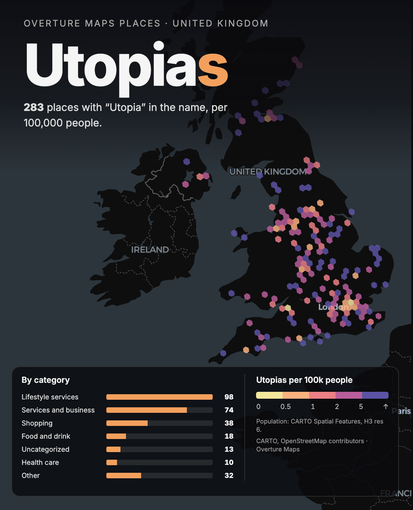

# Day 8 · Utopia: places with "Utopia" in the name, per 100,000 people

283 places in the UK have "Utopia" in the name. Adjusted for population, the Highlands beat London.

Page: https://abenrob.github.io/30daymap2026/day-08-utopia/

## What it shows

Every place in Overture Maps Places for the UK with "Utopia" in its name, binned into H3 hexagons and divided by population. Lifestyle services lead with 98, then services and business with 74, shopping with 38, food and drink with 18, uncategorized with 13, health care with 10 and other with 32.

Per 100,000 people the highest rates are in sparsely populated areas (the Highlands, Lincolnshire, Norfolk, Cornwall). London has many Utopias and far more people to dilute them. This is the small-numbers problem: one place in a hexagon with few residents gives a high rate.

## How it was made

Built in [CARTO App Studio](https://carto.com/blog/generative-spatial-apps-hosted-in-carto/) (private preview, announced 5 November 2026) as a test of how quickly a new tool gets from an idea to a finished map. The app was described in a prompt, built against the live data in the warehouse, and refined by clicking elements in the preview and describing the change (for example, clicking the attribution and asking for it to move underneath the legend). App Studio apps are not public, so the result is published here as an image and there are no scripts.

## Data

| What | Source | Licence |
| --- | --- | --- |
| Places | Overture Maps Places | CDLA Permissive 2.0 |
| Population | CARTO Spatial Features, H3 resolution 6 | CARTO Data Observatory terms |
| Basemap | © CARTO, © OpenStreetMap contributors | ODbL (OSM data) |
