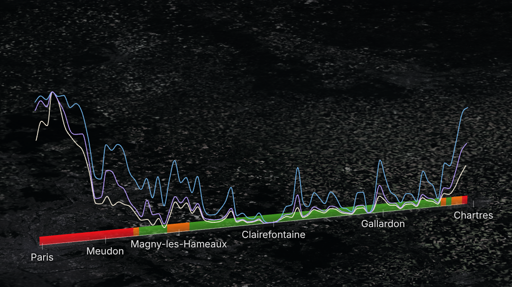

# Day 9 · Urban-rural

One straight line from Notre-Dame to Chartres cathedral, 78 km. It is traced in turn by population density, sealed ground and built volume, then coloured by the official Degree of Urbanisation class. The finale lays all three over the class. [Watch the video](https://abenrob.github.io/30daymap2026/day-09-urban-rural/) or [scrub the interactive version](https://abenrob.github.io/30daymap2026/day-09-urban-rural/explore.html).



## Data

- **Population:** GHS-POP R2023A, epoch 2020, 100 m, Mollweide tile R4_C19. European Commission, Joint Research Centre, CC BY 4.0.
- **Built volume:** GHS-BUILT-V R2023A, epoch 2020, 100 m, same tile and licence. Not an input to the Degree of Urbanisation.
- **Official class:** GHS-SMOD R2023A, epoch 2020, 1 km, same tile and licence. Degree of Urbanisation level 1: urban centre (30), urban cluster (21 to 23), rural (11 to 13).
- **Sealed ground:** Copernicus High Resolution Layer Imperviousness Density 2018, 10 m, from the EEA ImageServer (`GioLandPublic/HRL_ImperviousnessDensity_2018`), reprojected to Lambert-93 by the server. © European Union, Copernicus Land Monitoring Service, EEA.
- **Base image:** IGN orthophotos (`ORTHOIMAGERY.ORTHOPHOTOS`) via the Géoplateforme WMTS, loaded live in the page. Licence Ouverte 2.0.
- **Commune names:** geo.api.gouv.fr, at each window centre.

GHS-SMOD and GHS-BUILT-S also exist for a single-family run; GHS-BUILT-S was the fallback for sealed ground and was not needed.

## Method

1. `01_transect.py`: straight line in Lambert-93 from Paris (point zéro, 2.3488 E 48.8534 N) to Chartres cathedral (1.4875 E 48.4478 N), 77.8 km, one sample every 1 km (78 samples).
2. `02_fetch_hrl.py`: imperviousness for the line's bounding box plus 3 km, in two strips.
3. `03_sample.py`: each sample owns a window 1 km along the line and 3 km across. A 10 m point lattice (30,000 points) reads every layer in its own projection. Population and built volume are means over the window converted to per km² and m³ per m² of ground; sealed ground is the mean percentage; the class is the majority class by area. Heights are `sqrt(value / maximum on the line)`, because a linear scale leaves the last 60 km flat.
4. `04_preview.py`: static check chart.
5. `05_communes.py`: commune at each window centre, for the labels.
6. The page (`explore.html` + `app.js`, three.js 0.160) loads `profile/profile.json`. Profiles are smoothed with a monotone cubic through the samples (passes through every value, never overshoots). Every visual is a pure function of time `t`: `explore.html?t=12.5` opens on one frame and `renderAt(t)` draws any frame.
7. `06_render_frames.js`: Playwright opens the page in capture mode, waits for the orthophoto tiles, steps through 1,216 frames at 30 fps, and screenshots each one. ffmpeg stitches them.

## Results

| km | Commune | People/km² | Sealed | Built volume (m³/m²) | Official class |
| --- | --- | ---: | ---: | ---: | --- |
| 3 | Paris (peak) | 33,963 | 87% | 9.16 | Urban centre |
| 10 | Meudon | 2,041 | 16% | 0.69 | Urban centre |
| 16 | Jouy-en-Josas | 1,386 | 16% | 0.49 | Urban centre |
| 24 | Magny-les-Hameaux | 1,421 | 20% | 0.52 | Urban cluster |
| 46 | Sonchamp | 252 | 11% | 0.27 | Rural |
| 61 | Gallardon | 420 | 11% | 0.31 | Rural |
| 77 | Chartres | 2,391 | 38% | 1.59 | Urban centre |

- Along the line: 18 km urban centre, 8 km urban cluster, 52 km rural.
- km 27 to 72 (Chevreuse to Gasville-Oisème) is rural for all 46 km, median 44 people per km², while sealed ground reaches 11% at villages and roads.
- Jouy-en-Josas and Magny-les-Hameaux, 8 km apart, have the same density in the swath and different classes: the Degree of Urbanisation classes cells by density and by the cluster they belong to.

Limits: one straight line, so the profile depends on where it happens to cross towns and forests (it passes 5 km from Versailles and 3 km from Rambouillet). The window is fixed at 1 x 3 km. The class is a window majority and can differ from the cell under the line (km 28, Chevreuse, is rural by majority, urban cluster at the centre). Sealed ground is 2018, the GHSL layers 2020.

## Recreate it

Python 3.10+ with numpy, rasterio, pyproj, shapely and matplotlib; Node with Playwright; ffmpeg.

```
mkdir -p work/day-09 && cd work/day-09 && mkdir raw
# GHSL tiles (R4_C19) into raw/, unzipped:
B=https://jeodpp.jrc.ec.europa.eu/ftp/jrc-opendata/GHSL
curl -O $B/GHS_POP_GLOBE_R2023A/GHS_POP_E2020_GLOBE_R2023A_54009_100/V1-0/tiles/GHS_POP_E2020_GLOBE_R2023A_54009_100_V1_0_R4_C19.zip
curl -O $B/GHS_BUILT_V_GLOBE_R2023A/GHS_BUILT_V_E2020_GLOBE_R2023A_54009_100/V1-0/tiles/GHS_BUILT_V_E2020_GLOBE_R2023A_54009_100_V1_0_R4_C19.zip
curl -O $B/GHS_BUILT_S_GLOBE_R2023A/GHS_BUILT_S_E2020_GLOBE_R2023A_54009_100/V1-0/tiles/GHS_BUILT_S_E2020_GLOBE_R2023A_54009_100_V1_0_R4_C19.zip
curl -O $B/GHS_SMOD_GLOBE_R2023A/GHS_SMOD_E2020_GLOBE_R2023A_54009_1000/V2-0/tiles/GHS_SMOD_E2020_GLOBE_R2023A_54009_1000_V2_0_R4_C19.zip
(cd raw && for z in ../*.zip; do unzip -o $z; done)

S=../../site/day-09-urban-rural/scripts
python3 $S/01_transect.py && python3 $S/02_fetch_hrl.py && python3 $S/03_sample.py && python3 $S/04_preview.py
mkdir -p ../../site/day-09-urban-rural/profile && cp profile.json transect.json ../../site/day-09-urban-rural/profile/
(cd ../../site/day-09-urban-rural && python3 scripts/05_communes.py)

# video: serve site/, then capture and stitch
(cd ../../site && python3 -m http.server 8099 &)
mkdir frames && node $S/06_render_frames.js http://localhost:8099/day-09-urban-rural/explore.html frames
ffmpeg -framerate 30 -i frames/%05d.png -c:v libx264 -pix_fmt yuv420p -crf 18 -movflags +faststart day-09-urban-rural.mp4
```
