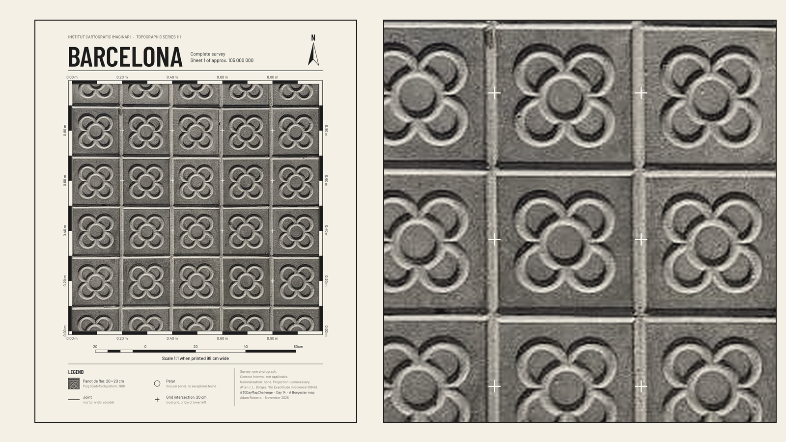

# Day 14 · A Borgesian map: Barcelona at 1:1

A map sheet of Barcelona with nothing generalised away: one photo of the panot de flor, the 20 x 20 cm flower tile that paves the city's pavements, laid out as an official sheet. Printed 98 cm wide it is the same size as the ground it shows, so the municipality's 101 km² would need about 105 million sheets. After Borges, "On Exactitude in Science" (1946).



`images/barcelona.png` is the full 2400 x 3000 sheet.

## Numbers

- Tile pitch measured in the photo by autocorrelation: 83 px per 20 cm tile. The graduated border, local grid and scale bar all follow from it.
- Sheet covers 98.6 cm of ground; 101.4 km² / (0.986 m)² is about 105 million sheets.
- The source photo is 409 px wide, upscaled about 4.5x.

## Data

| What | Source | Notes |
| --- | --- | --- |
| Photo of panot de flor paving | City of Barcelona, [Instagram post](https://www.instagram.com/p/DZHluF-o_Nn/) | Credited in the post. |
| Fonts | Barlow and Barlow Condensed | SIL Open Font License. |

## Run

```
pip install pillow
python scripts/make_map.py photo.jpg barcelona.png fonts/
```
