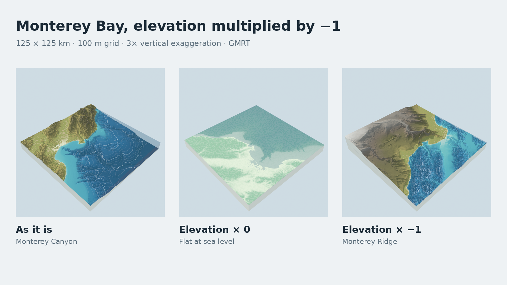

# Day 15 · Inside out: Monterey Bay with elevation multiplied by -1

Every elevation in a 100 m grid around Monterey Bay, California, multiplied by -1 and animated. Sea level stays at 0, so the coastline does not move: the Santa Lucia range and the Salinas Valley go under the sea, and the continental slope (down to about 3,500 m in this crop) comes up as land, with Monterey Canyon turned into a ridge. The camera swings 180 degrees as it flips, so the sea is always in the foreground.



`images/morph.gif` is the post animation (4:5, loops).

## Numbers

- Crop: 125 x 125 km, 100 m cells, UTM zone 10N (EPSG:26910). Elevation in the crop runs from -3,504 m to 1,765 m.
- Vertical exaggeration 3x, set as the object's Z scale in Blender (1 Blender unit = 1 km).
- Animation: 150-frame timeline, symmetric around frame 75; frames 13 to 61 are rendered (49 frames, 1080 x 1080, Cycles, 48 samples) and played forward, held, then in reverse.

## Data

| What | Source | Notes |
| --- | --- | --- |
| Land and seafloor elevation | [GMRT](https://www.gmrt.org) GridServer, Ryan et al. 2009, *Geochemistry, Geophysics, Geosystems* | One grid for land and ocean. Check gmrt.org for the terms of use. |
| Where the seafloor is measured | GMRT `topo-mask` layer | Marks cells with high-resolution multibeam soundings; everything else is coarse gap-fill. |

## Method

1. **Fetch** (`01_fetch_dem.py`). Request a wider scout area from GMRT (`topo` and `topo-mask`), warp both to UTM 10N at 100 m with area averaging, write `dem_utm.tif` and `surveyed_utm.tif`.
2. **Prepare** (`02_prepare.py`). Fill small holes, trim ocean edges that are mostly gap-fill (`--auto-crop`), run sanity checks (Junipero Serra Peak near 1,788 m, deepest point west of it, coast near Moss Landing), write `terrain.npz` and a preview image. The data keeps its original elevations: the inversion is done in Blender.
3. **Build** (`03_build_blender.py`). The mesh is built from the numpy array. One shape key holds the inverted surface (Z negated); animating its value from 0 to 1 and back is the whole morph. One material picks the look from the height of the surface as displayed: above 0 a land palette (with rock on steep slopes and snow on the highest ground), below 0 a depth-tinted seabed with isobaths. Around the flat midpoint every cell crosses sea level at once, so the land and sea blend widens as the terrain flattens and the colours dissolve instead of popping. Water is a translucent plane at sea level. `--block` adds the diorama slab; `--sun-follow` turns the sun with the camera so the light always comes from the viewer's upper left.
4. **Compose** (`04_compose.py`). Put each square frame on a 4:5 canvas with a header (the name changes from Canyon to Ridge at the flat midpoint) and a footer readout, then build the GIF and MP4.

## Run

Needs Python 3.10+ with the packages in `scripts/requirements.txt` and Blender 4.x or 5.x. Run from a working folder outside the repo (data and `.blend` files are gitignored):

```
python scripts/01_fetch_dem.py --data-dir scripts/data
python scripts/02_prepare.py --auto-crop
/Applications/Blender.app/Contents/MacOS/Blender --background --python scripts/03_build_blender.py -- \
    --npz scripts/data/terrain.npz --out morph.blend --morph --block --square --sun-follow --sun-az 315 \
    --aspect 1:1 --width 1080 --tilt 42 --ve 3 --cam-start 315 --cam-end 495 \
    --render-anim frames --frames 13-61 --samples 48
python scripts/04_compose.py frames --out post --mirror
```

Add `--frames 37` to render the flat midpoint alone as a quick framing check.

## Notes

- Close-ups can use 2 to 5 m USGS/CSUMB/MBARI or NOAA CUDEM tiles via `--detail` in step 1; mind the vertical datum (NAVD88 vs MSL) at the seam.
- If the Mac render is slow, lower `--samples` or `--width`; the look is unchanged.
