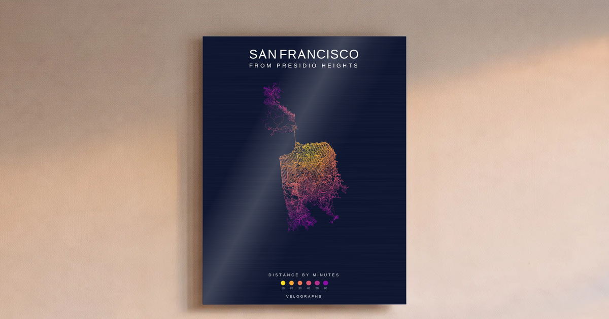

# Day 16 · Collaborative map: Velographs, how far you can cycle in an hour

Velographs is a site where anyone could make a custom poster of how far they can cycle in an hour from any point on Earth. I built it with Ryan Morris: I coded and built the posters, Ryan automated it and built the site around it.

The poster above is San Francisco from Presidio Heights at 20 mph, in the Sunset colour style, with the roads coloured by ten-minute band out to 60 minutes. Site: https://www.velographs.com/

## Cartography by omission

The map is only the lines of the roads and paths you can reach. No hill, mountain or coastline is drawn, yet you can see them, because roads cannot go there. The bay and the ocean are simply empty.

## Credits

- Automation and site: [Ryan Morris](https://www.linkedin.com/in/morrisabroad/)
- Reach: line-based multigraph isolines from the [Targomo](https://www.linkedin.com/company/targomo/) API
- Roads: © [OpenStreetMap](https://www.openstreetmap.org/copyright) contributors, ODbL

## Code

Not shared. This day has no scripts folder.
