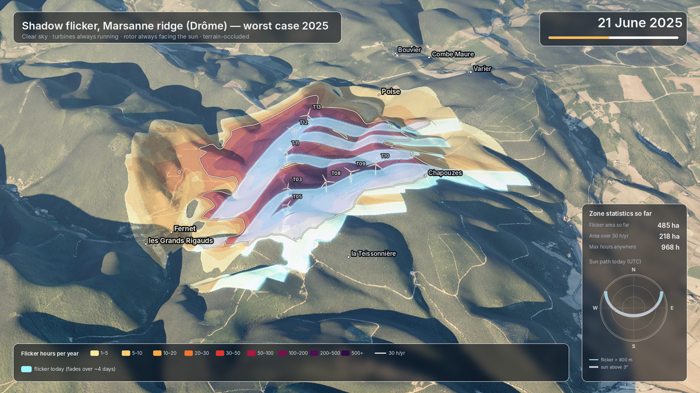

# Day 17 · Light & dark: worst-case shadow flicker on the Marsanne ridge, every minute of 2025

Where the wind turbines on the Marsanne ridge (Drôme, France) can cast shadow flicker, the strobe a spinning rotor makes when the sun is low behind it. All daylight minutes of 2025 are tested in the worst case: clear sky, rotors always turning and always yawed to face the sun. The terrain is real, so ridges block low sun. The animation steps through the year one day at a time: that day's flicker in cyan over the cumulative hours per year.



Turbine dimensions are assumed (see Data), so this illustrates the method. It is not a permitting study.

## Numbers

- 8 turbines, 283,189 cells at 5 m within 10 rotor diameters, 251,564 daylight minutes above 3° sun elevation.
- Model run: about 9 minutes on 2 CPU cores, 2.2 GB peak RAM. Horizon table: about 2 minutes, then cached.
- Area over 30 h/yr: 307 ha with terrain blocking, 383 ha without it (total flicker hours down 12%).
- Checked against a brute-force per-minute test with its own ray-marched terrain: 62 of 64 cell-days identical, the other 2 off by 1 minute.

## Data

| What | Source | Notes |
| --- | --- | --- |
| Terrain | IGN RGE ALTI 5 m, WMS-R layer `RGEALTI-MNT_PYR-ZIP_FXX_LAMB93_WMS` | Licence Ouverte 2.0. Bare ground, so trees are not counted. |
| Aerial imagery | IGN BD ORTHO, WMS-R layer `HR.ORTHOIMAGERY.ORTHOPHOTOS` | Licence Ouverte 2.0. 1 m for the scene, 2 m for the outer terrain. |
| Turbines, buildings, place names | IGN BD TOPO V3 via WFS (`construction_ponctuelle` where nature = Eolienne, `batiment`, `zone_d_habitation`, `lieu_dit_non_habite`, `detail_orographique`) | Licence Ouverte 2.0. |
| Turbine dimensions | Assumed: Vestas V117 (117 m rotor, about 90 m hub, from the 150 m maximum tip height) for the six repowered turbines (T08 to T13); V80 (80 m rotor, 67 m hub) for the western pair (T03, T05) | From thewindpower.net and the MRAe notice for the repowering. The five turbines on the eastern plateau are left out: model unknown. |

All in Lambert-93 (EPSG:2154), clipped to 845000, 6395500, 855500, 6403000.

## Method

1. **Sun** (`src/solar.py`). pvlib sun position every minute of 2025 in UTC, keeping elevations above 3°. Azimuths are rotated by the Lambert-93 grid convergence (1.36° here).
2. **Flicker** (`src/flicker.py`, `src/geometry.py`). The rotor is a sphere of radius D/2 around the hub, and the hub swings 6 m toward the sun as the rotor yaws. From any ground point at 1.5 m, the rotor covers a small circle of sky; flicker happens when the sun is inside it. The year's sun directions go into a BallTree, and each cell queries it once per turbine, then an exact test with the yaw-dependent hub. The result is a per-day stack of minutes (days x rows x cols), counted once per minute across turbines.
3. **Terrain** (`src/terrain.py`). A horizon angle per cell for 360 azimuth bins, out to 5 km. A minute counts only if the sun is above the local horizon.
4. **Scene** (`scripts/blender_scene.py`). Terrain mesh from the DEM (1.5x vertical exaggeration) with BD ORTHO draped, buildings extruded from BD TOPO heights, turbines at their dimensions. Rendered once in Cycles, with a pass that stores the Lambert-93 position of the terrain in every pixel.
5. **Animation** (`scripts/compose_v2.py`). Each frame looks up the model rasters through that position pass: cumulative hours, the day's flicker with a 4-day fade, the 30 h/yr line, labels and a sun-path inset. Then ffmpeg, 2 frames per day.

## Run

Needs Python 3.11+ with numpy, pandas, pvlib, scikit-learn, scipy, rasterio, pyproj, matplotlib, pyyaml, Pillow, OpenEXR, and `bpy` (Blender 5.x as a Python module) for the scene. Data paths are in `config.yaml`.

```
python scripts/flat_test.py            # flat-terrain sanity checks
python scripts/run_site.py             # the year on the real terrain
python scripts/spotcheck_site.py       # brute-force check
python scripts/run_flags_far.py 800    # per-minute flags for the sun-path inset
python scripts/blender_scene.py --format 16x9
python scripts/compose_v2.py --format 16x9 --tag v3
```

## Notes

- Worst case on purpose: real flicker depends on cloud, wind direction and whether the turbines run, which would cut these hours sharply.
- The sun is a point and the rotor a sphere, both standard simplifications. Blade width is ignored.
- Only the sun direction is checked against the terrain, and terrain beyond the DEM edge is ignored.
