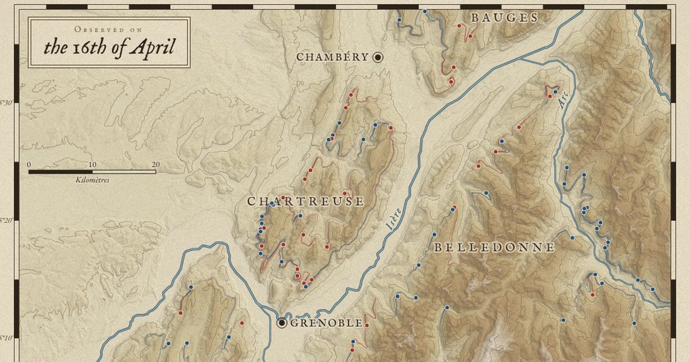

# Day 18 · Null: the seasonal circuits of the dahu

Plate XVII. One year in the life of 160 dahus (*Dahutus montanus*) in the mountains around Grenoble and Chambéry: the Chartreuse, Vercors, Belledonne, Taillefer and Bauges. The dahu's legs are shorter on one side, so it can only circle a mountain one way. The dextrogyre variety (red) goes clockwise and the lévogyre variety (blue) anticlockwise. They spiral down to winter range in autumn and back up in spring, and favour a different slope aspect each season.



Live plate: https://abenrob.github.io/30daymap2026/day-18-null/

## Numbers

- 160 individuals: Chartreuse 34, Vercors 34, Belledonne 44, Taillefer 22, Bauges 26.
- Winter range 780 to 1,130 m (mid-February), summer range 1,500 to 2,400 m (mid-August), capped 180 m below each massif's summit.
- Favoured aspect turns clockwise through the year: south-west in mid-January, north-west in mid-April, north-east in mid-July, south-east in mid-October.
- Map extent 5.185 to 6.518 E, 44.93 to 45.64 N (about 104 x 79 km). Basemap DEM 2,880 x 2,160 cells (about 36 m).
- 912 frames at 0.4 days per frame: 30.4 s at 30 fps.

## Data

| What | Source | Notes |
| --- | --- | --- |
| Terrain | IGN BD ALTI, WMS-R layer `ELEVATION.ELEVATIONGRIDCOVERAGE`, `image/x-bil;bits=32` | Licence Ouverte 2.0. 3 x 3 requests of 960 x 720 for the basemap; one 880 x 740 request over a wider box for the movement grid. |
| Rivers | IGN BD TOPO V3 `cours_d_eau` via WFS | Licence Ouverte 2.0. Isère, Drac, Romanche, Arc; importance 5 features carry the full-detail line. |
| Skeleton | Drawing after the Musée des Sciences Nocturnes | Title, number and logo removed, recoloured as sepia ink. |
| Dahus | Agent model, `plate_template.html` | See Method. |

## Method

1. **Terrain** (`01_fetch_dem.py`, `01b_fetch_dem_sim.py`). Raw float32 elevation from the Géoplateforme WMS-R. The CRS is EPSG:4326, so the WMS 1.3.0 BBOX is lat,lon.
2. **Rivers** (`02_fetch_rivers.py`). WFS GetFeature with a CQL filter on the names. Inside CQL, BBOX takes lon,lat.
3. **Basemap** (`03_basemap.py`). Layer tints from pale valley to umber, a soft north-west hillshade, and contours every 100 m (500 m index) drawn with matplotlib at 1,904 x 1,440.
4. **Rivers and grid for the page** (`04_export_rivers_grid.py`). Rivers clipped, merged and simplified, then converted to kilometres from Grenoble (equirectangular at 45.29 N). The movement grid is the wider DEM smoothed and resampled to 440 x 370 (about 300 m), packed as uint16.
5. **Skeleton** (`05_skeleton_ink.py`).
6. **Movement** (in `plate_template.html`). Each step, a dahu moves along the local contour (the terrain gradient turned 90 degrees, one way or the other by variety), plus a correction toward its seasonal target elevation. Its speed is scaled by 1 - 0.9 cos(aspect - favoured aspect), so it lingers on slopes facing the season's direction and hurries through the rest. It never reverses. The page starts after one silent warm-up year, so the loop is seamless.
7. **Page and video** (`06_build_page.py`, `07_record_frames.py`). The build inlines the basemap, skeleton, rivers and grid into one HTML file. The recorder steps the page frame by frame in headless Chromium and screenshots the 1080 x 1350 stage; ffmpeg makes the MP4 and the GIF.

## Run

Python 3.10+ with numpy, scipy, matplotlib, shapely, Pillow and playwright, plus ffmpeg.

```
python scripts/01_fetch_dem.py
python scripts/01b_fetch_dem_sim.py
python scripts/02_fetch_rivers.py
python scripts/03_basemap.py          # basemap.png; save as basemap.jpg (quality 86) for the page
python scripts/04_export_rivers_grid.py
python scripts/05_skeleton_ink.py     # needs skel.gif
python scripts/06_build_page.py       # expects the template as atlas.html and the inputs in geo/ and plate/
python scripts/07_record_frames.py index.html frames/
```
