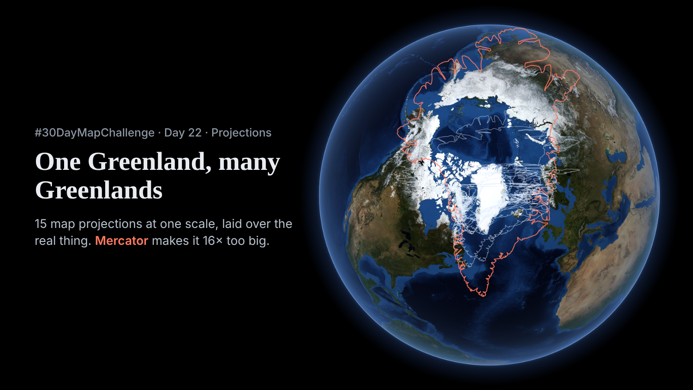

# Day 22 · Projections: one Greenland, many Greenlands

The video opens on NASA's Blue Marble, centred on Greenland, and the imagery itself is reprojected from the globe into Mercator before it fades into the flat map. Greenland then goes through 15 map projections at one shared scale. A red dashed outline of its true shape is fitted onto every frame by rotation and translation only, so a projection that merely turns or moves Greenland matches it exactly and whatever gap remains is real distortion. Each frame is scored on area and on shape. The finale pulls back to the whole globe, the page goes from paper to black, and the flat globe becomes the Blue Marble again, so the last frame matches the first and the video loops.



Live page: https://abenrob.github.io/30daymap2026/day-22-projections/ (40 s loop, click to pause)

## Numbers

Same globe radius in every frame; Greenland's centroid (41.8 W, 73.1 N) at the stage centre. Area is relative to the true area; shape off is the residual after the best rotate + shift + scale fit (0% = identical shape, see Method).

| # | Projection | Property | Area | Shape off |
| --- | --- | --- | --- | --- |
| 1 | Mercator | Conformal | ×16 | 26% |
| 2 | Miller | Compromise | ×7.7 | 41% |
| 3 | Plate Carrée | Equidistant | ×3.8 | 63% |
| 4 | Gall–Peters | Equal-area | ×1.00 | 73% |
| 5 | Van der Grinten | Compromise | ×6.8 | 20% |
| 6 | Sinusoidal | Equal-area | ×1.00 | 25% |
| 7 | Mollweide | Equal-area | ×1.00 | 38% |
| 8 | Eckert IV | Equal-area | ×1.00 | 61% |
| 9 | Robinson | Compromise | ×2.2* | 51% |
| 10 | Winkel tripel | Compromise | ×1.85 | 34% |
| 11 | Natural Earth | Compromise | ×1.87 | 53% |
| 12 | Equal Earth | Equal-area | ×1.00 | 62% |
| 13 | Peirce quincuncial (centred on the North Pole) | Conformal | ×0.77* | 1% |
| 14 | Lambert azimuthal equal-area, centred on Greenland | Equal-area | ×1.00 | 0.0% |
| 15 | Orthographic, centred on Greenland | Perspective | ×0.99 | 0.2% |

\* Wrong in the video: d3 draws these two at the wrong size for the shared radius (see Limitations). The correct values are Robinson ×1.61 and Peirce quincuncial ×1.05. Their shape scores are not affected.

The selection keeps the world projections people actually meet, every projection named in the post, and only two of the near-identical local projections at the end. An earlier cut with 23 also scored Gall stereographic (×3.7, 42%), Lambert cylindrical equal-area (×1.00, 81%), Bonne (×1.00, 12%), Hammer (×1.00, 29%), Bertin 1953 (×0.84, 7%), Lambert conformal conic centred on Greenland (×0.99, 0.4%), polar stereographic EPSG:3413 (×0.99, 1%) and polar azimuthal equidistant (×1.02, 0.7%).

- Equal-area does not buy shape: Gall–Peters, Eckert IV and Equal Earth are all exact on area and 61 to 73% off on shape.
- Conformal (angles kept locally, so a constant compass bearing is a straight line on Mercator) only holds locally. Mercator is still 26% off, because its scale factor runs from 2 at Greenland's south tip (60 N) to about 8 at the north coast (83 N). Peirce quincuncial, also conformal but centred on the North Pole, is 1% off.
- Every projection at 1% or less is centred on the pole or on Greenland.
- Greenland's true area is 2.17 million km².

## Method

1. **Geometry** (`02_prep_geometry.mjs`). Greenland's main island from Natural Earth 1:50m, densified along great circles to 0.25° steps (1,984 points), plus its five larger islands, neighbouring land (29 rings: Canada's Arctic and mainland, Iceland, Svalbard), a local graticule and world land at 1:110m for the globe.
2. **One scale** (`page.js`). Every projection uses the same d3 `scale` (the globe radius in pixels) and is translated so Greenland's centroid sits at the stage centre. The radius is the largest that fits every Greenland in the frame except Mercator's, which runs off the top and bottom on purpose. Watch for d3 raw functions that are not at true scale on a unit sphere: d3's stereographic is tan(c/2), half the textbook 2·tan(c/2), and d3 makes up for it with a larger default scale (250). It is not in the final cut, but in the 23-projection version EPSG:3413 first came out at a quarter of the true area.
3. **True outline**. Greenland in Lambert azimuthal equal-area centred on its own centroid, at the same radius. Over an area Greenland's size that is the true shape and area to within a fraction of a percent.
4. **Fit and scores**. The same geographic points are projected in every frame, so point *i* of the projected outline and point *i* of the true outline are the same place. The best rotation is orthogonal Procrustes in closed form (θ = atan2(Σ cross, Σ dot) after centring both); the outline is drawn rotated by θ and moved to the projected shape's mean, never scaled. Shape off = √(1 − r² / (‖A‖² ‖B‖²)), the normalised residual after the best similarity fit (r = |Σ dot + i Σ cross|). Area = shoelace area of the projected main island / true area. Both scores are recomputed on the in-between shapes during each morph.
5. **Morphs**. Linear point-by-point interpolation between the two projected point sets with a cubic ease (0.8 s), then a 1 s hold. Earlier projections leave thin outlines that fade with age to a light trace.
6. **Cold open** (`page.js`). The first 1.5 s are the final frame: the Blue Marble on black. Over the next 3 s the imagery is reprojected from orthographic (globe radius 472 px) to Mercator in WebGL: the texture sits on a 1.5° lon/lat mesh over the visible hemisphere, each vertex carries both screen positions, and the vertex shader blends them, so the photo stretches and zooms with the vector outlines. The fragment shader repeats the globe's lighting and haze and lets it go as the globe flattens. The image then fades into the vector map and the background turns to paper; the true outline and scores appear on Mercator. Mercator has to cut the globe somewhere at the pole, so the mesh is cut on the meridian directly behind Greenland (Mercator centred on 41.8 W, which only shifts it sideways), its polar cap above 84 N is squashed instead of running to infinity, and cells far from Greenland or above 80 N fade as the cut opens. Without WebGL the page falls back to a crossfade.
7. **Globe** (`page.js`). The orthographic frame pulls back to a whole globe (radius 440 px), still centred on Greenland. The background fades from paper to black while the vector globe crossfades to the Blue Marble, drawn per pixel: inverse orthographic projection to lon/lat, bilinear sample of the 4096 x 2048 equirectangular texture, light from the upper left, limb darkening, a blue haze toward the rim and a glow behind the disc.
8. **Video** (`03_build_page.mjs`, `04_record.py`). The build inlines d3, d3-geo-projection, the geometry, the texture and `page.js` into one 2.7 MB `index.html`. The recorder steps `render(t)` at 30 fps in headless Chromium and pipes the frames into ffmpeg (H.264, CRF 18): 1,195 frames, 39.8 s, 1080 x 1350.

## Limitations

- Scores use the main island only; the offshore islands are drawn but not scored.
- Two area scores in the video are wrong, because d3's raw functions for these projections are not at standard scale on a unit sphere (the same issue as d3's stereographic, see Method step 2). d3's Robinson leaves out the 0.8487 x-factor and uses π/2 instead of 1.3523 for y, so it is about 17% too large in each direction: ×2.2 shown, ×1.61 correct. d3's Peirce quincuncial has a scale of 0.854 at the pole, where it should be 1: ×0.77 shown, ×1.05 correct. Shape scores are unaffected, since the fit removes scale. To fix, multiply those two projections' scale in `page.js` by 0.8487 (Robinson) and 1/0.8536 (Peirce), then rerun 03 and 04. Found by recomputing every score with PROJ 9.8 (Robinson and Peirce areas differed from d3; all 15 shape scores matched to within 0.1 points).
- The shape score compares outlines (full Procrustes: shift, rotate, uniform scale), not intrinsic distortion. Checked against Tissot measures over Greenland's interior, a scale-normalised Airy–Kavrayskiy ranks the projections almost the same way (Spearman 0.98), while angular distortion alone ranks them quite differently (0.89): Mercator and Peirce both score 0° there, since conformal projections keep angles locally.
- World projections keep their default central meridian (0°), as on the world maps people see. Centring them on 42 W would cut most of the shear.
- The cold-open unfold is a straight interpolation between the orthographic and Mercator positions of each mesh vertex, not a physical unrolling of the sphere. The cut behind the pole shows briefly as a dark slot at the top of the globe.
- The Blue Marble copy is 4096 x 2048 (about 10 km per pixel at the equator) and shows heavy snow over Canada and Siberia, so Greenland stands out less than in a summer mosaic. Swapping in a July Blue Marble Next Generation image is a one-file change (`bluemarble.jpg`).

## Sources

| What | Source |
| --- | --- |
| Greenland, neighbours, world land | Natural Earth 1:50m and 1:110m (public domain), via world-atlas 2.0.2 (npm) |
| Globe imagery | NASA Blue Marble with bathymetry (NASA Earth Observatory, public domain); the 4096 x 2048 copy that ships in the three-globe 2.45.6 npm package |
| Projections | d3-geo 3 (in d3 7.9.2) and d3-geo-projection 4.0.0, ISC licence |

## Layout

```
index.html                  the live page (built, self-contained)
images/preview.png          card and social preview (1600 x 900)
scripts/package.json        JS dependencies, pinned
scripts/01_fetch.sh         npm install + the Blue Marble texture
scripts/02_prep_geometry.mjs Natural Earth -> data.json
scripts/page.js             the animation: projections, fit, scores, timeline, globe
scripts/03_build_page.mjs   page.js + data + texture + d3 -> ../index.html
scripts/04_record.py        index.html -> MP4 (or --stills T ... for review frames)
scripts/05_preview.py       images/preview.png
```

## Run

Node 18+, Python 3.10+ with playwright and Pillow, ffmpeg. Data and renders go to `work/day-22-projections` next to the repo, or `$D22_WORK`.

```
cd scripts
bash 01_fetch.sh
node 02_prep_geometry.mjs
node 03_build_page.mjs
python 04_record.py
python 05_preview.py
```
